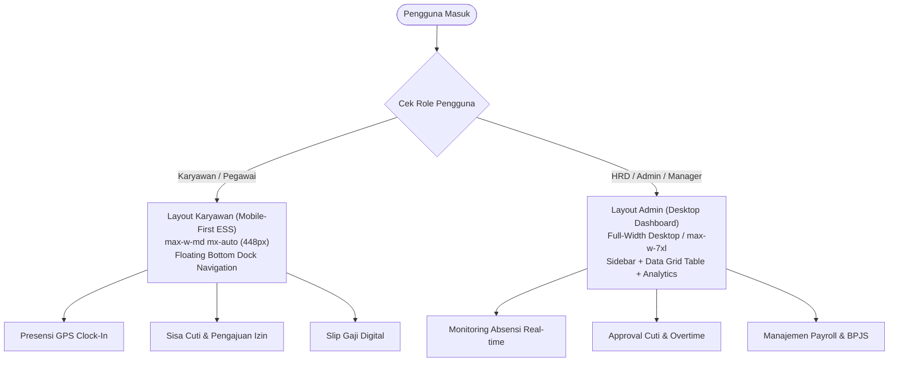

# Product Requirements Document (PRD) — UI/UX Design System
# HRIS Corporate (Human Resource Information System)

> **Status**: Approved Architecture & Design Specification  
> **Aesthetic Core**: High-End Apple iOS / visionOS Glassmorphism (Borderless, Zero Box-Shadow)  
> **Color Theme**: Biru Korporat (Executive Corporate Navy & Royal Blue)  
> **Typography**: Google Fonts Poppins (Clean, Geometris, Enterprise-Grade)  
> **Dual Architecture**: Mobile-First Karyawan (`max-w-md mx-auto`) & Desktop Admin Dashboard (`max-w-[1440px]`)

---

## 1. Executive Summary & Design Philosophy

Sistem Desain HRIS Korporat ini dirancang untuk menghadirkan pengalaman digital enterprise yang menggabungkan ketenangan dan keanggunan estetika **Apple iOS Glassmorphism** dengan ketegasan identitas korporat berbasis **Biru Korporat (Navy/Blue)**.

### Prinsip Desain Fundamental (Invariants):
1. **Borderless Glassmorphism Murni**:
   - **DILARANG KERAS menggunakan border kaku** (`border: 1px solid` atau `border: 1px dashed`) pada kartu, panel, badge, tabel, dialog modal, maupun floating widget.
   - Kedalaman visual (*visual depth*) dan hierarki dibangun murni menggunakan kombinasi **tonal kontras permukaan semi-transparan (`rgba`)** dan **frosted blur (`backdrop-filter: blur(20px)`)**.
2. **Zero Box Shadow**:
   - **DILARANG menggunakan `box-shadow`** di seluruh elemen antarmuka. Elevasi diciptakan melalui pemisahan lapisan kaca (*frosted glass layers*) dan pencahayaan latar belakang (*ambient backdrops*).
3. **Zero Gradient pada Kartu & Light Mode Flat**:
   - Seluruh kartu dan panel dilarang memakai `linear-gradient` atau `radial-gradient` warna-warni.
   - Pada mode terang (*Light Mode*), background aplikasi wajib berupa warna flat/polos solid murni (`#F8FAFC`), menciptakan kanvas yang tenang dan nyaman di mata untuk penggunaan kerja berjam-jam.
4. **Universal Zero-Scrollbar**:
   - Seluruh scrollbar pada browser desktop dan mobile wajib dihilangkan secara deklaratif murni CSS (`scrollbar-width: none;`). Konten tetap dapat di-scroll secara mulus tanpa visual clutter scrollbar.
5. **Anti-AI Slop & Minimalist Copywriting**:
   - Bahasa antarmuka harus singkat, padat, lugas, dan profesional (1–3 kata per label), bebas dari kalimat motivasi klise atau penjelasan bertele-tele.

---

## 2. Sistem Warna: Biru Korporat (Navy & Blue Palette)

Warna utama sistem beralih penuh ke spektrum **Corporate Navy & Electric Blue**, mencerminkan profesionalisme, keamanan data, reliabilitas, dan efisiensi manajemen sumber daya manusia.

### 2.1 CSS Variables / Design Tokens

```css
/* ==========================================================================
   HRIS Corporate Design Tokens
   ========================================================================== */
:root {
  --font-family: 'Poppins', -apple-system, BlinkMacSystemFont, 'Segoe UI', Roboto, Helvetica, Arial, sans-serif;
  --transition-fast: 0.15s cubic-bezier(0.4, 0, 0.2, 1);
  --transition-normal: 0.25s cubic-bezier(0.4, 0, 0.2, 1);

  /* Border Radius Hierarchy */
  --radius-xs: 4px;
  --radius-sm: 8px;     /* Small tags, micro controls */
  --radius-md: 12px;    /* Buttons, inputs, dropdown items */
  --radius-lg: 16px;    /* Cards, attendance widgets, employee cards */
  --radius-xl: 22px;    /* Top headers, modal dialogs, KPI panels */
  --radius-full: 9999px; /* Pills, avatar rings, floating bottom dock */
}

/* --------------------------------------------------------------------------
   Dark Mode: Executive Midnight Navy (Default)
   -------------------------------------------------------------------------- */
:root[data-theme="dark"],
html[data-theme="dark"] {
  /* Canvas & Backgrounds */
  --bg-app: #0A0F1D;                           /* Deepest Midnight Navy */
  --bg-gradient: radial-gradient(circle at 15% 15%, #131E36 0%, #0A0F1D 70%);
  --bg-card: rgba(16, 26, 48, 0.72);           /* Glassmorphic Navy */
  --bg-card-hover: rgba(22, 36, 68, 0.82);
  --bg-card-solid: #0F1A30;
  --bg-surface: rgba(255, 255, 255, 0.04);
  --bg-surface-hover: rgba(255, 255, 255, 0.08);
  --bg-surface-active: rgba(255, 255, 255, 0.12);

  /* Typography */
  --text-primary: #F8FAFC;                     /* Slate 50 */
  --text-secondary: #94A3B8;                   /* Slate 400 */
  --text-muted: #64748B;                       /* Slate 500 */
  --text-inverse: #0A0F1D;

  /* Primary Brand: Corporate Electric Blue */
  --accent-primary: #2563EB;                   /* Royal / Electric Blue */
  --accent-primary-hover: #3B82F6;
  --accent-primary-soft: rgba(37, 99, 235, 0.15);
  --accent-primary-text: #FFFFFF;

  /* Secondary Brand: Deep Royal Navy */
  --accent-secondary: #1D4ED8;
  --accent-secondary-soft: rgba(29, 78, 216, 0.15);

  /* Strict Semantic Status Colors (Functional Only) */
  --status-success: #10B981;                   /* Emerald (Hadir Tepat Waktu, Disetujui) */
  --status-success-soft: rgba(16, 185, 129, 0.15);
  --status-warning: #F59E0B;                   /* Amber (Menunggu Approval, Terlambat) */
  --status-warning-soft: rgba(245, 158, 11, 0.15);
  --status-danger: #F43F5E;                    /* Rose (Alpha, Ditolak, Surat Peringatan) */
  --status-danger-soft: rgba(244, 63, 94, 0.15);
  --status-info: #0EA5E9;                      /* Sky (Pengumuman, Informasi Cuti) */
  --status-info-soft: rgba(14, 165, 233, 0.15);

  /* Table & Chart Elements */
  --chart-grid: rgba(255, 255, 255, 0.06);
  --chart-slot: rgba(255, 255, 255, 0.04);
  --border-glass: transparent;                 /* Absolute zero border */
}

/* --------------------------------------------------------------------------
   Light Mode: Crisp Corporate Slate
   -------------------------------------------------------------------------- */
:root[data-theme="light"],
html[data-theme="light"] {
  /* Canvas & Backgrounds */
  --bg-app: #F8FAFC;                           /* Crisp Pure Slate 50 (Flat, No Gradient) */
  --bg-gradient: #F8FAFC;
  --bg-card: rgba(255, 255, 255, 0.88);        /* High-opacity Frosted Glass */
  --bg-card-hover: rgba(255, 255, 255, 0.96);
  --bg-card-solid: #FFFFFF;
  --bg-surface: rgba(15, 23, 42, 0.04);
  --bg-surface-hover: rgba(15, 23, 42, 0.07);
  --bg-surface-active: rgba(15, 23, 42, 0.10);

  /* Typography */
  --text-primary: #0F172A;                     /* Slate 900 (Navy Tinted Black) */
  --text-secondary: #475569;                   /* Slate 600 */
  --text-muted: #64748B;                       /* Slate 500 */
  --text-inverse: #FFFFFF;

  /* Primary Brand: Corporate Blue */
  --accent-primary: #1D4ED8;                   /* Rich Corporate Blue 700 */
  --accent-primary-hover: #1E40AF;             /* Deep Blue 800 */
  --accent-primary-soft: rgba(29, 78, 216, 0.10);
  --accent-primary-text: #FFFFFF;

  /* Secondary Brand */
  --accent-secondary: #2563EB;
  --accent-secondary-soft: rgba(37, 99, 235, 0.10);

  /* Strict Semantic Status Colors */
  --status-success: #059669;                   /* Green 600 */
  --status-success-soft: rgba(5, 150, 105, 0.12);
  --status-warning: #D97706;                   /* Amber 600 */
  --status-warning-soft: rgba(217, 119, 6, 0.12);
  --status-danger: #E11D48;                    /* Rose 600 */
  --status-danger-soft: rgba(225, 29, 72, 0.12);
  --status-info: #0284C7;                      /* Sky 600 */
  --status-info-soft: rgba(2, 132, 199, 0.12);

  /* Table & Chart Elements */
  --chart-grid: rgba(15, 23, 42, 0.06);
  --chart-slot: rgba(15, 23, 42, 0.04);
  --border-glass: transparent;                 /* Absolute zero border */
}
```

---

## 3. Tailwind CSS Configuration Guide (`tailwind.config.js`)

Bagi tim teknis yang mengimplementasikan frontend dengan **Tailwind CSS**, gunakan konfigurasi terstandar berikut agar seluruh warna korporat, radius, dan utility glassmorphism terpetakan 1:1:

```javascript
/** @type {import('tailwindcss').Config} */
module.exports = {
  darkMode: ['class', '[data-theme="dark"]'],
  content: ['./index.html', './src/**/*.{vue,js,ts,jsx,tsx}'],
  theme: {
    extend: {
      colors: {
        hris: {
          bg: 'var(--bg-app)',
          card: 'var(--bg-card)',
          'card-hover': 'var(--bg-card-hover)',
          'card-solid': 'var(--bg-card-solid)',
          surface: 'var(--bg-surface)',
          'surface-hover': 'var(--bg-surface-hover)',
          'surface-active': 'var(--bg-surface-active)',
          text: 'var(--text-primary)',
          'text-secondary': 'var(--text-secondary)',
          'text-muted': 'var(--text-muted)',
          primary: 'var(--accent-primary)',
          'primary-hover': 'var(--accent-primary-hover)',
          'primary-soft': 'var(--accent-primary-soft)',
          secondary: 'var(--accent-secondary)',
          success: 'var(--status-success)',
          'success-soft': 'var(--status-success-soft)',
          warning: 'var(--status-warning)',
          'warning-soft': 'var(--status-warning-soft)',
          danger: 'var(--status-danger)',
          'danger-soft': 'var(--status-danger-soft)',
          info: 'var(--status-info)',
          'info-soft': 'var(--status-info-soft)',
        },
      },
      fontFamily: {
        sans: ['Poppins', '-apple-system', 'BlinkMacSystemFont', 'sans-serif'],
      },
      borderRadius: {
        sm: '8px',
        md: '12px',
        lg: '16px',
        xl: '22px',
        full: '9999px',
      },
      backdropBlur: {
        glass: '20px',
      },
      maxWidth: {
        employee: '28rem', // 448px (max-w-md strictly locked)
        admin: '1440px',   // Desktop wide container
      },
      spacing: {
        'dock-clearance': 'max(150px, calc(120px + env(safe-area-inset-bottom)))',
      },
    },
  },
  plugins: [
    // Custom Utility Plugin: Borderless Glass & No-Scrollbars
    function ({ addUtilities }) {
      addUtilities({
        '.glass-card': {
          background: 'var(--bg-card)',
          'backdrop-filter': 'blur(20px)',
          '-webkit-backdrop-filter': 'blur(20px)',
          border: 'none',
          'border-radius': 'var(--radius-lg)',
          transform: 'translateZ(0)',
          '-webkit-transform': 'translateZ(0)',
        },
        '.no-scrollbar': {
          '-ms-overflow-style': 'none',
          'scrollbar-width': 'none',
          '&::-webkit-scrollbar': {
            display: 'none !important',
            width: '0 !important',
            height: '0 !important',
          },
        },
      });
    },
  ],
};
```

---

## 4. Tipografi & Hierarki Teks (Font Poppins)

Font resmi adalah **Poppins** (Google Fonts).

### 4.1 Muat Font via Preconnect di `index.html`
```html
<link rel="preconnect" href="https://fonts.googleapis.com">
<link rel="preconnect" href="https://fonts.gstatic.com" crossorigin>
<link href="https://fonts.googleapis.com/css2?family=Poppins:wght@300;400;500;600;700;800&display=swap" rel="stylesheet">
```

### 4.2 Skala & Karakter Tipografi
| Token Teks | Ukuran | Weight | Line Height | Letter Spacing | Penggunaan di HRIS |
| :--- | :--- | :--- | :--- | :--- | :--- |
| **Display / Clock** | `2.25rem` (36px) | `700` (Bold) | `1.15` | `-0.03em` | Jam digital live clock-in presensi |
| **Page Title** | `1.35rem` (21px) | `700` (Bold) | `1.25` | `-0.02em` | Judul modul utama (Presensi, Cuti, Payroll) |
| **Section Heading** | `1.05rem` (16px) | `600` (SemiBold) | `1.35` | `-0.01em` | Header kartu widget, sub-seksi dashboard |
| **Body Primary** | `0.92rem` (14px) | `400` / `500` | `1.50` | `normal` | Nama karyawan, nilai tabel, input formulir |
| **Body Secondary** | `0.80rem` (12px) | `400` / `500` | `1.40` | `normal` | Jabatan, NIP, tanggal presensi, helper text |
| **Badge / Micro Pill**| `0.68rem` (10px) | `600` / `700` | `1.20` | `+0.06em` | Status "HADIR", "TERLAMBAT", "PROSESS", "APPROVED" |

---

## 5. Dual-Layout Architecture

HRIS ini memisahkan antarmuka menjadi **2 arsitektur layout yang berbeda secara tegas**:



---

### 5.1 LAYOUT KARYAWAN: Wajib Dikunci Mobile-First (`max-w-md mx-auto`)

Antarmuka Employee Self-Service (ESS) difungsikan untuk penggunaan smartphone harian pegawai (Presensi GPS, Face Validation, Pengajuan Izin, Cuti, dan Slip Gaji).

#### A. Aturan Layout:
1. **Container Kunci**: Container utama wajib menggunakan kelas `max-w-md mx-auto` (lebar maksimal **448px**) dan berada di tengah layar desktop secara proporsional.
2. **Natural Document Scrolling**:
   - `html, body`: Dilarang mengunci `overflow: hidden; height: 100%;` untuk mencegah terpotongnya viewport di Safari iOS PWA.
   - Gunakan `min-height: 100dvh` dengan `padding-bottom: max(150px, calc(120px + env(safe-area-inset-bottom))) !important;` agar konten terbawah tidak tertutup floating bottom dock.
3. **Floating Bottom Navigation Dock (`.app-bottom-dock`)**:
   - Menu navigasi melayang berbentuk kapsul (*pill*) terpusat di bagian bawah layar.
   - Pilihan tab utama Karyawan (5 Tab):
     1. **Beranda**: Ringkasan jadwal hari ini, shift kerja, status presensi.
     2. **Presensi**: Tombol Clock-In / Clock-Out dengan verifikasi GPS & kamera.
     3. **Pengajuan (+)**: Tombol aksi tengah menonjol untuk Cuti, Izin Sakit, atau Lembur.
     4. **Slip Gaji**: Rekap gaji bulanan dan rincian potongan.
     5. **Akun**: Profil karyawan, data kepegawaian, switch tema.
4. **Touch Interactions (Zero Sticky Hover)**:
   - Dilarang memberi efek `:hover` yang mengubah warna pada tombol mobile karena akan menempel (*sticky hover*) di layar sentuh iPhone/Android.
   - Gunakan feedback sentuhan haptic mikro:
     ```css
     button:active {
       transform: scale(0.96);
       transition: transform 0.1s ease;
     }
     ```

#### B. Template Struktur HTML/Vue (Karyawan):
```html
<template>
  <div class="employee-shell min-h-screen bg-[var(--bg-app)] text-[var(--text-primary)]">
    <!-- Container Dikunci Mobile-First: max-w-md (448px) -->
    <main class="max-w-md mx-auto px-4 pt-4 pb-[var(--spacing-dock-clearance)] flex flex-col gap-5 relative">
      
      <!-- Top Bar: Avatar, Nama & Status Shift -->
      <header class="glass-card p-4 flex items-center justify-between">
        <div class="flex items-center gap-3">
          <div class="w-11 h-11 rounded-full bg-[var(--accent-primary-soft)] text-[var(--accent-primary)] flex items-center justify-center font-bold text-base">
            DA
          </div>
          <div>
            <h2 class="text-sm font-bold tracking-tight">Daffa Al-Ghifari</h2>
            <p class="text-xs text-[var(--text-secondary)]">Software Engineer • IT Division</p>
          </div>
        </div>
        <span class="px-2.5 py-1 rounded-full text-[10px] font-semibold tracking-wider uppercase bg-[var(--status-success-soft)] text-[var(--status-success)]">
          Shift Pagi
        </span>
      </header>

      <!-- Widget Utama: Presensi Cepat (Live GPS & Clock) -->
      <section class="glass-card p-5 flex flex-col items-center gap-4 text-center">
        <span class="text-xs font-medium text-[var(--text-muted)] tracking-wide">Senin, 19 Oktober 2026</span>
        <div class="text-4xl font-bold tracking-tight text-[var(--text-primary)] font-mono">
          08:24:15 <span class="text-xs font-sans text-[var(--text-secondary)]">WIB</span>
        </div>
        
        <div class="w-full flex items-center justify-center gap-2 py-2 px-3 rounded-xl bg-[var(--bg-surface)] text-xs text-[var(--text-secondary)]">
          <svg class="w-4 h-4 text-[var(--accent-primary)]" fill="none" viewBox="0 0 24 24" stroke="currentColor">
            <path stroke-linecap="round" stroke-linejoin="round" stroke-width="2" d="M17.657 16.657L13.414 20.9a1.998 1.998 0 01-2.827 0l-4.244-4.243a8 8 0 1111.314 0z" />
          </svg>
          <span>Kantor Pusat Jakarta (Dalam Radius 50m)</span>
        </div>

        <button type="button" class="w-full py-3.5 px-6 rounded-xl bg-[var(--accent-primary)] hover:bg-[var(--accent-primary-hover)] text-white font-semibold text-sm transition-all active:scale-[0.98]">
          Clock-In Masuk
        </button>
      </section>

      <!-- Quick KPI Counters Karyawan (Sisa Cuti, Terlambat, Hadir) -->
      <section class="grid grid-cols-3 gap-3">
        <div class="glass-card p-3 flex flex-col items-center text-center gap-1">
          <span class="text-[11px] font-medium text-[var(--text-muted)]">Sisa Cuti</span>
          <span class="text-lg font-bold text-[var(--accent-primary)]">12 Hari</span>
        </div>
        <div class="glass-card p-3 flex flex-col items-center text-center gap-1">
          <span class="text-[11px] font-medium text-[var(--text-muted)]">Hadir Bulan Ini</span>
          <span class="text-lg font-bold text-[var(--status-success)]">18 Hari</span>
        </div>
        <div class="glass-card p-3 flex flex-col items-center text-center gap-1">
          <span class="text-[11px] font-medium text-[var(--text-muted)]">Terlambat</span>
          <span class="text-lg font-bold text-[var(--status-warning)]">0x</span>
        </div>
      </section>

    </main>

    <!-- Floating Bottom Navigation Dock -->
    <nav class="fixed bottom-5 left-1/2 -translate-x-1/2 z-50 w-auto max-w-[92vw]">
      <div class="flex items-center gap-2 px-3 py-1.5 rounded-full bg-[rgba(16,26,48,0.92)] dark:bg-[rgba(16,26,48,0.92)] light:bg-[rgba(255,255,255,0.95)] backdrop-blur-2xl border-none">
        <button class="flex flex-col items-center gap-0.5 px-3 py-1.5 text-[var(--accent-primary)] text-[10px] font-medium">
          <svg class="w-5 h-5" fill="none" viewBox="0 0 24 24" stroke="currentColor"><path stroke-linecap="round" stroke-linejoin="round" stroke-width="2" d="M3 12l2-2m0 0l7-7 7 7M5 10v10a1 1 0 001 1h3m10-11l2 2m-2-2v10a1 1 0 01-1 1h-3m-6 0a1 1 0 001-1v-4a1 1 0 011-1h2a1 1 0 011 1v4a1 1 0 001 1m-6 0h6"/></svg>
          Beranda
        </button>
        <button class="flex flex-col items-center gap-0.5 px-3 py-1.5 text-[var(--text-muted)] text-[10px] font-medium">
          <svg class="w-5 h-5" fill="none" viewBox="0 0 24 24" stroke="currentColor"><path stroke-linecap="round" stroke-linejoin="round" stroke-width="2" d="M12 8v4l3 3m6-3a9 9 0 11-18 0 9 9 0 0118 0z"/></svg>
          Presensi
        </button>
        <button class="w-10 h-10 -my-2 rounded-full bg-[var(--accent-primary)] text-white flex items-center justify-center">
          <svg class="w-5 h-5" fill="none" viewBox="0 0 24 24" stroke="currentColor"><path stroke-linecap="round" stroke-linejoin="round" stroke-width="2.5" d="M12 4v16m8-8H4"/></svg>
        </button>
        <button class="flex flex-col items-center gap-0.5 px-3 py-1.5 text-[var(--text-muted)] text-[10px] font-medium">
          <svg class="w-5 h-5" fill="none" viewBox="0 0 24 24" stroke="currentColor"><path stroke-linecap="round" stroke-linejoin="round" stroke-width="2" d="M9 12h6m-6 4h6m2 5H7a2 2 0 01-2-2V5a2 2 0 012-2h5.586a1 1 0 01.707.293l5.414 5.414a1 1 0 01.293.707V19a2 2 0 01-2 2z"/></svg>
          Slip Gaji
        </button>
        <button class="flex flex-col items-center gap-0.5 px-3 py-1.5 text-[var(--text-muted)] text-[10px] font-medium">
          <svg class="w-5 h-5" fill="none" viewBox="0 0 24 24" stroke="currentColor"><path stroke-linecap="round" stroke-linejoin="round" stroke-width="2" d="M16 7a4 4 0 11-8 0 4 4 0 018 0zM12 14a7 7 0 00-7 7h14a7 7 0 00-7-7z"/></svg>
          Akun
        </button>
      </div>
    </nav>
  </div>
</template>
```

---

### 5.2 LAYOUT ADMIN: Desktop Dashboard Standar (`max-w-[1440px]`)

Antarmuka Admin/HRD dirancang untuk produktivitas manajemen tingkat tinggi: membaca puluhan baris data presensi, menyetujui lembur/cuti secara massal, mengekspor laporan payroll, dan memantau status staf real-time.

#### A. Aturan Layout:
1. **Struktur Grid Dashboard**:
   - **Sidebar Navigasi Kiri (Lebar 260px)**: Sticky fixed navigation dengan logo perusahaan, modul HR (Karyawan, Presensi, Cuti, Payroll, Rekrutmen, Pengaturan), dan status branch/cabang kantor.
   - **Main Content Area (Flexible `1fr`, max 1440px)**: Area kerja utama berisi header top bar, ringkasan KPI eksekutif, dan data table interaktif.
2. **Top Header Bar**:
   - Kolom pencarian universal (*Global Search Karyawan via NIP/Nama*).
   - Filter Cabang/Perusahaan (*Multi-Company Dropdown*).
   - Indikator Notifikasi Pending Approvals dengan badge counter.
   - Profil Admin & Tombol Toggle Tema.
3. **KPI Metrics Grid (4 Kolom)**:
   - Total Karyawan Aktif (`1,248 Pegawai`).
   - Kehadiran Hari Ini (`96.4%` — Hadir tepat waktu).
   - Karyawan Cuti / Izin Hari Ini (`28 Orang`).
   - Menunggu Persetujuan / Pending Overtime (`7 Permintaan`).
4. **Data Table Enterprise Tanpa Border Kaku**:
   - Header tabel menggunakan background semi-transparan dengan teks `text-[var(--text-muted)]` huruf kecil semi-bold.
   - Baris data menggunakan efek hover lembut (`bg-[var(--bg-surface-hover)]`) tanpa garis tepi wireframe.
   - Status diwakili oleh kapsul *pill* fungsional (Hijau = Hadir, Kuning = Pending, Merah = Alpha).

#### B. Template Struktur HTML/Vue (Admin):
```html
<template>
  <div class="admin-dashboard-layout flex min-h-screen bg-[var(--bg-app)] text-[var(--text-primary)]">
    
    <!-- 1. Left Sidebar Navigation (260px Fixed) -->
    <aside class="w-[260px] h-screen sticky top-0 flex flex-col justify-between p-4 bg-[var(--bg-card)] backdrop-blur-2xl border-none">
      <div class="flex flex-col gap-6">
        <!-- Brand Header -->
        <div class="flex items-center gap-3 px-2">
          <div class="w-9 h-9 rounded-xl bg-[var(--accent-primary)] text-white flex items-center justify-center font-bold">
            HR
          </div>
          <div>
            <h1 class="text-sm font-bold tracking-tight text-[var(--text-primary)]">NEXUS HRIS</h1>
            <p class="text-[11px] text-[var(--text-muted)]">Enterprise Edition</p>
          </div>
        </div>

        <!-- Navigation Links -->
        <nav class="flex flex-col gap-1.5" aria-label="Menu Admin">
          <a href="#/dashboard" class="flex items-center gap-3 px-3 py-2.5 rounded-xl bg-[var(--accent-primary-soft)] text-[var(--accent-primary)] font-medium text-xs">
            <svg class="w-4 h-4" fill="none" viewBox="0 0 24 24" stroke="currentColor"><path stroke-linecap="round" stroke-linejoin="round" stroke-width="2" d="M4 6a2 2 0 012-2h2a2 2 0 012 2v2a2 2 0 01-2 2H6a2 2 0 01-2-2V6zM14 6a2 2 0 012-2h2a2 2 0 012 2v2a2 2 0 01-2 2h-2a2 2 0 01-2-2V6zM4 16a2 2 0 012-2h2a2 2 0 012 2v2a2 2 0 01-2 2H6a2 2 0 01-2-2v-2zM14 16a2 2 0 012-2h2a2 2 0 012 2v2a2 2 0 01-2 2h-2a2 2 0 01-2-2v-2z"/></svg>
            Dashboard
          </a>
          <a href="#/employees" class="flex items-center gap-3 px-3 py-2.5 rounded-xl text-[var(--text-secondary)] hover:bg-[var(--bg-surface-hover)] hover:text-[var(--text-primary)] font-medium text-xs transition-colors">
            <svg class="w-4 h-4" fill="none" viewBox="0 0 24 24" stroke="currentColor"><path stroke-linecap="round" stroke-linejoin="round" stroke-width="2" d="M12 4.354a4 4 0 110 5.292M15 21H3v-1a6 6 0 0112 0v1zm0 0h6v-1a6 6 0 00-9-5.197M13 7a4 4 0 11-8 0 4 4 0 018 0z"/></svg>
            Data Karyawan
          </a>
          <a href="#/attendance" class="flex items-center gap-3 px-3 py-2.5 rounded-xl text-[var(--text-secondary)] hover:bg-[var(--bg-surface-hover)] hover:text-[var(--text-primary)] font-medium text-xs transition-colors">
            <svg class="w-4 h-4" fill="none" viewBox="0 0 24 24" stroke="currentColor"><path stroke-linecap="round" stroke-linejoin="round" stroke-width="2" d="M8 7V3m8 4V3m-9 8h10M5 21h14a2 2 0 002-2V7a2 2 0 00-2-2H5a2 2 0 00-2 2v12a2 2 0 002 2z"/></svg>
            Rekap Presensi
          </a>
          <a href="#/leave-requests" class="flex items-center gap-3 px-3 py-2.5 rounded-xl text-[var(--text-secondary)] hover:bg-[var(--bg-surface-hover)] hover:text-[var(--text-primary)] font-medium text-xs transition-colors">
            <svg class="w-4 h-4" fill="none" viewBox="0 0 24 24" stroke="currentColor"><path stroke-linecap="round" stroke-linejoin="round" stroke-width="2" d="M9 5H7a2 2 0 00-2 2v12a2 2 0 002 2h10a2 2 0 002-2V7a2 2 0 00-2-2h-2M9 5a2 2 0 002 2h2a2 2 0 002-2M9 5a2 2 0 012-2h2a2 2 0 012 2"/></svg>
            Approval Cuti & Izin
            <span class="ml-auto px-1.5 py-0.5 rounded-full text-[10px] font-bold bg-[var(--status-warning-soft)] text-[var(--status-warning)]">7</span>
          </a>
          <a href="#/payroll" class="flex items-center gap-3 px-3 py-2.5 rounded-xl text-[var(--text-secondary)] hover:bg-[var(--bg-surface-hover)] hover:text-[var(--text-primary)] font-medium text-xs transition-colors">
            <svg class="w-4 h-4" fill="none" viewBox="0 0 24 24" stroke="currentColor"><path stroke-linecap="round" stroke-linejoin="round" stroke-width="2" d="M12 8c-1.657 0-3 .895-3 2s1.343 2 3 2 3 .895 3 2-1.343 2-3 2m0-8c1.11 0 2.08.402 2.599 1M12 8V7m0 1v8m0 0v1m0-1c-1.11 0-2.08-.402-2.599-1M21 12a9 9 0 11-18 0 9 9 0 0118 0z"/></svg>
            Payroll & Gaji
          </a>
        </nav>
      </div>

      <!-- User Profile Card in Sidebar -->
      <div class="glass-card p-3 flex items-center justify-between">
        <div class="flex items-center gap-2.5">
          <div class="w-8 h-8 rounded-full bg-[var(--accent-primary)] text-white flex items-center justify-center text-xs font-bold">
            AD
          </div>
          <div>
            <p class="text-xs font-bold">Admin Utama</p>
            <p class="text-[10px] text-[var(--text-muted)]">HR Director</p>
          </div>
        </div>
      </div>
    </aside>

    <!-- 2. Main Desktop View Area -->
    <div class="flex-1 flex flex-col p-6 gap-6 max-w-[1440px]">
      
      <!-- Top Bar: Global Search & Quick Actions -->
      <header class="glass-card p-4 flex items-center justify-between">
        <div class="w-96 flex items-center gap-2 px-3 py-2 rounded-xl bg-[var(--bg-surface)] text-xs text-[var(--text-secondary)]">
          <svg class="w-4 h-4 text-[var(--text-muted)]" fill="none" viewBox="0 0 24 24" stroke="currentColor"><path stroke-linecap="round" stroke-linejoin="round" stroke-width="2" d="M21 21l-6-6m2-5a7 7 0 11-14 0 7 7 0 0114 0z"/></svg>
          <input type="text" placeholder="Cari karyawan berdasarkan nama, NIP, atau departemen..." class="bg-transparent border-none outline-none w-full text-xs text-[var(--text-primary)] placeholder:text-[var(--text-muted)]" />
        </div>

        <div class="flex items-center gap-3">
          <button class="px-3.5 py-2 rounded-xl bg-[var(--bg-surface)] hover:bg-[var(--bg-surface-hover)] text-xs font-semibold flex items-center gap-2">
            <span>Kantor Pusat Jakarta</span>
            <svg class="w-3.5 h-3.5 text-[var(--text-muted)]" fill="none" viewBox="0 0 24 24" stroke="currentColor"><path stroke-linecap="round" stroke-linejoin="round" stroke-width="2" d="M19 9l-7 7-7-7"/></svg>
          </button>
          <button class="px-4 py-2 rounded-xl bg-[var(--accent-primary)] hover:bg-[var(--accent-primary-hover)] text-white text-xs font-semibold flex items-center gap-2">
            <svg class="w-4 h-4" fill="none" viewBox="0 0 24 24" stroke="currentColor"><path stroke-linecap="round" stroke-linejoin="round" stroke-width="2" d="M12 4v16m8-8H4"/></svg>
            Tambah Karyawan
          </button>
        </div>
      </header>

      <!-- KPI Executive Metric Cards (4 Columns) -->
      <section class="grid grid-cols-4 gap-4">
        <div class="glass-card p-5 flex flex-col gap-2">
          <span class="text-xs font-semibold text-[var(--text-muted)] uppercase tracking-wider">Total Karyawan</span>
          <div class="flex items-baseline justify-between">
            <span class="text-2xl font-bold text-[var(--text-primary)]">1,248</span>
            <span class="text-xs font-medium text-[var(--status-success)]">+12 bln ini</span>
          </div>
        </div>
        <div class="glass-card p-5 flex flex-col gap-2">
          <span class="text-xs font-semibold text-[var(--text-muted)] uppercase tracking-wider">Kehadiran Hari Ini</span>
          <div class="flex items-baseline justify-between">
            <span class="text-2xl font-bold text-[var(--status-success)]">96.4%</span>
            <span class="text-xs font-medium text-[var(--text-secondary)]">1,203 hadir</span>
          </div>
        </div>
        <div class="glass-card p-5 flex flex-col gap-2">
          <span class="text-xs font-semibold text-[var(--text-muted)] uppercase tracking-wider">Sedang Cuti / Izin</span>
          <div class="flex items-baseline justify-between">
            <span class="text-2xl font-bold text-[var(--status-info)]">28</span>
            <span class="text-xs font-medium text-[var(--text-secondary)]">2.2% staf</span>
          </div>
        </div>
        <div class="glass-card p-5 flex flex-col gap-2">
          <span class="text-xs font-semibold text-[var(--text-muted)] uppercase tracking-wider">Pending Approval</span>
          <div class="flex items-baseline justify-between">
            <span class="text-2xl font-bold text-[var(--status-warning)]">7</span>
            <span class="text-xs font-medium text-[var(--text-secondary)]">Perlu respon</span>
          </div>
        </div>
      </section>

      <!-- Data Table: Rekap Presensi Karyawan Hari Ini -->
      <section class="glass-card p-5 flex flex-col gap-4">
        <div class="flex items-center justify-between">
          <h3 class="text-sm font-bold tracking-tight">Presensi Karyawan Hari Ini</h3>
          <div class="flex items-center gap-2">
            <button class="px-3 py-1.5 rounded-lg bg-[var(--bg-surface)] text-xs font-medium">Export Excel</button>
            <button class="px-3 py-1.5 rounded-lg bg-[var(--bg-surface)] text-xs font-medium">Filter Status</button>
          </div>
        </div>

        <div class="overflow-x-auto">
          <table class="w-full text-left text-xs">
            <thead>
              <tr class="text-[var(--text-muted)] border-b border-[var(--bg-surface)]">
                <th class="py-3 px-3 font-semibold">KARYAWAN</th>
                <th class="py-3 px-3 font-semibold">DEPARTEMEN</th>
                <th class="py-3 px-3 font-semibold">JAM MASUK</th>
                <th class="py-3 px-3 font-semibold">LOKASI</th>
                <th class="py-3 px-3 font-semibold">STATUS</th>
                <th class="py-3 px-3 font-semibold text-right">AKSI</th>
              </tr>
            </thead>
            <tbody class="divide-y divide-[var(--bg-surface)]">
              <tr class="hover:bg-[var(--bg-surface-hover)] transition-colors">
                <td class="py-3 px-3 flex items-center gap-2.5">
                  <div class="w-7 h-7 rounded-full bg-[var(--accent-primary-soft)] text-[var(--accent-primary)] font-bold flex items-center justify-center text-[10px]">
                    DA
                  </div>
                  <div>
                    <p class="font-semibold text-[var(--text-primary)]">Daffa Al-Ghifari</p>
                    <p class="text-[10px] text-[var(--text-muted)]">NIP: 2026-0819</p>
                  </div>
                </td>
                <td class="py-3 px-3 text-[var(--text-secondary)]">IT Engineering</td>
                <td class="py-3 px-3 font-mono font-medium">08:24:15</td>
                <td class="py-3 px-3 text-[var(--text-secondary)]">Kantor Pusat (GPS)</td>
                <td class="py-3 px-3">
                  <span class="px-2 py-0.5 rounded-full text-[10px] font-semibold bg-[var(--status-success-soft)] text-[var(--status-success)]">
                    Tepat Waktu
                  </span>
                </td>
                <td class="py-3 px-3 text-right">
                  <button class="text-[var(--accent-primary)] hover:underline font-semibold">Detail</button>
                </td>
              </tr>
            </tbody>
          </table>
        </div>
      </section>

    </div>
  </div>
</template>
```

---

## 6. Spesifikasi Komponen & Modul HRIS

### 6.1 Status Semantic & Aturan Warna Indikator
Warna di luar Biru Korporat **HANYA boleh digunakan untuk fungsi status semantik**:
1. **Hijau (`--status-success`: `#10B981` / `#059669`)**:
   - Status presensi: Hadir tepat waktu (*Present On-Time*).
   - Pengajuan cuti/lembur: Disetujui (*Approved*).
   - Status transfer slip gaji: Berhasil terkirim (*Paid*).
2. **Kuning / Amber (`--status-warning`: `#F59E0B` / `#D97706`)**:
   - Status presensi: Terlambat (*Late Arrival*).
   - Pengajuan: Menunggu persetujuan atasan (*Pending Approval*).
   - Masa kontrak: Menjelang habis dalam 30 hari.
3. **Merah (`--status-danger`: `#F43F5E` / `#E11D48`)**:
   - Status presensi: Tidak hadir tanpa keterangan (*Absent / Alpha*).
   - Pengajuan: Ditolak (*Rejected*).
   - Aksi destruktif: Hapus akun, pemutusan hubungan kerja (PHK/Resign).
4. **Biru Langit / Sky (`--status-info`: `#0EA5E9` / `#0284C7`)**:
   - Karyawan sedang izin resmi / dinas luar kota.
   - Pengumuman memo internal perusahaan.

---

## 7. Checklist Implementasi Frontend & Quality Gate

Sebelum kode di-merge atau di-deploy ke production, pastikan seluruh kriteria berikut terpenuhi:

- [ ] **Zero Border Guarantee**: Tidak ada properti `border: 1px solid` atau `border: 1px dashed` pada elemen UI mana pun. Seluruh batas visual menggunakan tonal background atau `border: none`.
- [ ] **Zero Box-Shadow**: Tidak ada deklarasi `box-shadow` pada kartu atau tombol.
- [ ] **Layout Karyawan Mobile-First**: Halaman ESS terkunci sempurna pada `max-w-md mx-auto` (448px) dan tidak melebar tak beraturan di layar ultra-wide monitor.
- [ ] **Dock Safe Area Clearance**: Area bawah halaman karyawan memiliki padding minimal `padding-bottom: max(150px, calc(120px + env(safe-area-inset-bottom)))` agar kartu terbawah tidak pernah terpotong dock navigasi.
- [ ] **Layout Admin Desktop**: Halaman Admin menampilkan multi-column desktop dashboard lengkap dengan sidebar navigasi responsif dan table grid yang nyaman dibaca.
- [ ] **Typography Poppins**: Font Poppins terhubung via preconnect Google Fonts dengan fallback `-apple-system, BlinkMacSystemFont`.
- [ ] **Universal Zero Scrollbar**: Scrollbar tersembunyi secara murni deklaratif tanpa merusak interaksi scrolling natural pengguna.
- [ ] **Zero AI Slop**: Semua teks tombol dan header singkat (1–3 kata), profesional, dan bebas dari kalimat motivasi klise.
